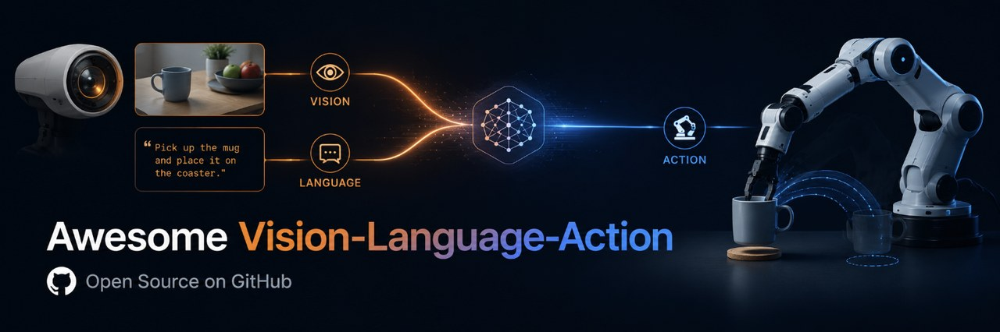

  
  <h1>🦾 Awesome Vision-Language-Action (VLA)</h1>
  
A curated list of Vision-Language-Action (VLA) models for robotics and embodied AI: foundation models, architectures, benchmarks, and datasets, with a focus on 2025–2026.

  

    
    
    
    
    
  

---

**Vision-Language-Action (VLA) models** map pixels and language instructions directly to robot actions, bringing internet-scale knowledge to embodied control. This list tracks the foundation models, action representations, benchmarks, and datasets driving the field — with a focus on 2025–2026 and open releases.

> Found a great model or paper we missed? [Contributions welcome](CONTRIBUTING.md).

---

## 📚 Contents

- [📖 Surveys & Overviews](#-surveys--overviews)
- [🤖 Generalist & Foundation VLA Models](#-generalist--foundation-vla-models)
- [🏗️ Architectures & Action Representations](#️-architectures--action-representations)
- [⚡ Efficient & Real-time VLA](#-efficient--real-time-vla)
- [🧠 Reasoning & World-model-augmented VLA](#-reasoning--world-model-augmented-vla)
- [🚗 Autonomous-Driving VLA](#-autonomous-driving-vla)
- [🧪 Data, Simulation & Benchmarks](#-data-simulation--benchmarks)
- [🗂️ Datasets](#️-datasets)
- [💻 Open-source Models & Code](#-open-source-models--code)
- [🔗 Related Awesome Lists](#-related-awesome-lists)

---

## 📖 Surveys & Overviews

- [A Survey on Vision-Language-Action Models for Embodied AI](https://arxiv.org/abs/2405.14093) — The first dedicated VLA survey; sets the now-standard taxonomy of components, control policies, and high-level task planners (later in IEEE TNNLS) (2024).
- [A Survey on Vision-Language-Action Models: An Action Tokenization Perspective](https://arxiv.org/abs/2507.01925) — Reframes the whole field around *how actions are tokenized* (language, code, affordance, trajectory, latent, raw), a genuinely useful lens for comparing architectures (2025).
- [Pure Vision Language Action (VLA) Models: A Comprehensive Survey](https://arxiv.org/abs/2509.19012) — Focuses specifically on end-to-end "pure" VLAs that map pixels+language straight to actions, and how they generalize across objects, scenes, and tasks (2025).
- [A Survey on Efficient Vision-Language-Action Models](https://arxiv.org/abs/2510.24795) — The first review centered on efficiency, splitting the pipeline into efficient model design, training, and data collection — increasingly the field's real bottleneck (2025).
- [Vision-Language-Action in Robotics: A Survey of Datasets, Benchmarks, and Data Engines](https://arxiv.org/abs/2604.23001) — A 2026 data-centric survey arguing that data engines, not architectures, are now the limiting factor in VLA progress (2026).
- [World Action Models: A Survey](https://arxiv.org/abs/2606.20781) — Defines the emerging World-Action-Model (WAM) paradigm that jointly learns a world model and a policy; the reference framing for the 2026 wave that fuses prediction and acting (2026).

## 🤖 Generalist & Foundation VLA Models

- [RT-1: Robotics Transformer for Real-World Control at Scale](https://arxiv.org/abs/2212.06817) — The seminal scale anchor: a 35M FiLM-EfficientNet + TokenLearner + Transformer that tokenizes images and instructions into discretized arm/base actions, proving multi-task real-robot control benefits from data scale (2022).
- [RT-2: Vision-Language-Action Models Transfer Web Knowledge to Robotic Control](https://arxiv.org/abs/2307.15818) — Coined the "VLA" framing: co-fine-tune an internet-scale VLM to emit actions as text tokens, yielding emergent generalization to unseen objects and instructions (2023).
- [OpenVLA: An Open-Source Vision-Language-Action Model](https://arxiv.org/abs/2406.09246) — The open-source reference point: a 7B model (DINOv2+SigLIP → Llama-2) trained on 970k Open-X demos that beats the 55B RT-2-X, and which nearly every later paper fine-tunes or ablates against (2024).
- [π0: A Vision-Language-Action Flow Model for General Robot Control](https://arxiv.org/abs/2410.24164) — Physical Intelligence's flagship: pairs a PaliGemma-class VLM with a flow-matching action expert to emit smooth, high-frequency continuous action chunks for dexterous cross-embodiment control (2024).
- [π0.5: a VLA with Open-World Generalization](https://arxiv.org/abs/2504.16054) — Co-trains π0 on heterogeneous multi-robot, web, and high-level subtask-prediction data to generalize to *entirely unseen homes* (e.g. cleaning a kitchen it has never seen) (2025).
- [π*0.6: a VLA That Learns From Experience (RECAP)](https://arxiv.org/abs/2511.14759) — Adds RECAP, RL via advantage-conditioned policies over demos, corrections, and autonomous experience, more than doubling throughput and roughly halving failures on the hardest real-world tasks ([blog](https://www.pi.website/blog/pistar06)) (2025).
- [Octo: An Open-Source Generalist Robot Policy](https://arxiv.org/abs/2405.12213) — Transformer with a diffusion action head and modular attention (language *or* goal-image conditioning), pretrained on 800k Open-X trajectories and easily fine-tuned to new sensors and action spaces (2024).
- [GR00T N1: An Open Foundation Model for Generalist Humanoid Robots](https://arxiv.org/abs/2503.14734) — NVIDIA's dual-system VLA: an Eagle-2 VLM "thinks" (System 2) while a DiT flow-matching policy emits high-frequency actions (System 1), released as an open 2.2B humanoid model (2025).
- [GR00T N1.7](https://huggingface.co/blog/nvidia/gr00t-n1-7) — NVIDIA's current open humanoid VLA (3B): a reasoning policy on a Cosmos-Reason2-2B backbone, pretrained on ~20K h of EgoScale human video; supersedes N1.5/N1.6 (released Apr 2026) (2026).
- [Gemini Robotics: Bringing AI into the Physical World](https://arxiv.org/abs/2503.20020) — A Gemini-2.0-based VLA plus a Gemini Robotics-ER embodied-reasoning model, delivering dexterous, reactive manipulation that stays robust to object and scene variation (2025).
- [Gemini Robotics 1.5](https://arxiv.org/abs/2510.03342) — Adds an agentic "think-before-acting" loop (GR-ER 1.5 plans with tools, GR 1.5 executes) plus an on-device VLA variant fine-tunable from ~50 demos (2025).
- [Helix: A VLA for Generalist Humanoid Control](https://www.figure.ai/news/helix) — Figure's proprietary VLA, notable as an early demonstration of high-rate continuous full upper-body humanoid control (fingers/wrists/torso/head) via a slow System-2 VLM plus an 80M fast System-1 controller, even coordinating two robots (2025).
- [LingBot-VLA: A Pragmatic VLA Foundation Model](https://arxiv.org/abs/2601.18692) — A cost-efficient foundation model trained on ~20,000 hours of dual-arm data across 9 robot configurations, with open code/models and strong cross-platform generalization (2026).
- [X-VLA: Soft-Prompted Transformer as Scalable Cross-Embodiment VLA](https://arxiv.org/abs/2510.10274) — ICLR 2026; a 0.9B flow-matching VLA using soft prompts for embodiment, setting SOTA across LIBERO / SimplerEnv / RoboTwin-2.0 / CALVIN — a standout open cross-embodiment result (2025).
- [InternVLA-M1: A Spatially Guided Vision-Language-Action Framework](https://arxiv.org/abs/2510.13778) — A spatially-grounded generalist policy (grounding pretrain → action post-train) with open code; a strong 2025-2026 open generalist alongside OpenVLA and π0 (2025).
- [WholebodyVLA](https://github.com/OpenDriveLab/WholebodyVLA) — ICLR 2026; a VLA for whole-body humanoid loco-manipulation, extending VLA control beyond tabletop arms to legs+torso+arms (2026).

## 🏗️ Architectures & Action Representations

### Diffusion-action

- [Diffusion Policy: Visuomotor Policy Learning via Action Diffusion](https://arxiv.org/abs/2303.04137) — The foundational diffusion-action head: represents the visuomotor policy as conditional denoising diffusion over action sequences, cleanly handling multimodal action distributions (2023).
- [CogACT: Synergizing Cognition and Action in Robotic Manipulation](https://arxiv.org/abs/2411.19650) — Cleanly decouples cognition from action by feeding a VLM backbone into a lightweight diffusion action transformer, a componentized design that became a common template (2024).
- [TinyVLA: Towards Fast, Data-Efficient VLA Models](https://arxiv.org/abs/2409.12514) — Drops autoregressive token generation for a diffusion head on a sub-1B VLM and skips robot-data pre-training, beating OpenVLA on speed and data efficiency (2024).

### Flow-matching & latent action

- [FAST: Efficient Action Tokenization for VLA Models](https://arxiv.org/abs/2501.09747) — A DCT/compression-based tokenizer (Frequency-space Action Sequence Tokenization) that lets autoregressive VLAs learn high-frequency dexterous tasks where naive per-dimension binning collapses (2025).
- [Latent Action Pretraining from Videos (LAPA)](https://arxiv.org/abs/2410.11758) — Learns discrete latent actions between video frames via a VQ-VAE, pretraining a VLA on *action-unlabeled* human video before mapping latents to robot actions (2024).

### Autoregressive & spatial/3D action

- [3D-VLA: A 3D VLA Generative World Model](https://arxiv.org/abs/2403.09631) — Builds a VLA on a 3D-LLM with embodied diffusion models that predict goal images and point clouds, tying 3D perception, reasoning, and action together (2024).
- [SpatialVLA: Exploring Spatial Representations for VLA](https://arxiv.org/abs/2501.15830) — Injects 3D via Ego3D position encoding and represents motion with adaptive *discretized spatial action grids*, a transferable spatial action vocabulary (2025).
- [PointVLA: Injecting the 3D World into VLA Models](https://arxiv.org/abs/2503.07511) — Adds point-cloud input to a *frozen* pretrained VLA through a lightweight modular block, avoiding retraining of the action expert (2025).
- [TraceVLA: Visual Trace Prompting](https://arxiv.org/abs/2412.10345) — Fine-tunes OpenVLA with overlaid past-trajectory points on the image to sharpen spatial-temporal awareness, a cheap representation trick with real gains (2024).
- [Towards Generalist Robot Policies: What Matters in Building VLA Models (RoboVLMs)](https://arxiv.org/abs/2412.14058) — A 600+ experiment sweep over 8 VLM backbones × 4 action-prediction formulations that turns "which architecture?" from folklore into evidence-backed design guidelines (2024).

## ⚡ Efficient & Real-time VLA

- [SmolVLA: A VLA for Affordable and Efficient Robotics](https://arxiv.org/abs/2506.01844) — A ~450M-param VLA trainable on one GPU and deployable on CPU, with async inference for ~2× task throughput, trained purely on community LeRobot data (2025).
- [DeeR-VLA: Dynamic Inference for Efficient Robot Execution](https://arxiv.org/abs/2411.02359) — A multi-exit MLLM with an action-consistency early-exit criterion that cuts compute 5-6× while preserving accuracy (2024).
- [OpenVLA-OFT: Fine-Tuning VLA Models — Optimizing Speed and Success](https://arxiv.org/abs/2502.19645) — Parallel decoding + continuous L1 action regression + action chunking lift OpenVLA from ~5 Hz/76.5% to >100 Hz/97.1% on LIBERO, a 26× throughput gain (2025).
- [RoboMamba: Efficient VLA for Robotic Reasoning and Manipulation](https://arxiv.org/abs/2406.04339) — Uses a Mamba state-space backbone for linear-complexity inference while tuning only a 3.7M-param (~0.1%) policy head to hit high control frequency (2024).
- [EdgeVLA: Efficient Vision-Language-Action Models](https://arxiv.org/abs/2507.14049) — Combines non-autoregressive end-effector prediction with small language models for ~7× speedup, targeting real-time on-robot edge deployment (2025).
- [FASTER: Rethinking Real-Time Flow VLAs](https://arxiv.org/abs/2603.19199) — Adaptive inference scheduling that prioritizes immediate actions to slash reaction latency in flow-based VLAs, validated on a high-speed table-tennis task (2026).
- [Efficient Long-Horizon VLA via Static-Dynamic Disentanglement](https://arxiv.org/abs/2602.03983) — Separates static scene context from dynamic content to escape the limited input-frame window and quadratic-attention cost of long-horizon VLAs (2026).

## 🧠 Reasoning & World-model-augmented VLA

- [Robotic Control via Embodied Chain-of-Thought Reasoning (ECoT)](https://arxiv.org/abs/2407.08693) — Trains VLAs to reason over plans, subtasks, and visually grounded features (bounding boxes, gripper positions) before acting, lifting OpenVLA success by 28% with no new robot data (2024).
- [Emma-X: Embodied Multimodal Action Model with Grounded CoT and Look-ahead Spatial Reasoning](https://arxiv.org/abs/2412.11974) — A 7B OpenVLA derivative that predicts grounded subtask reasoning plus 2D/3D gripper targets, trained on 60k auto-annotated BridgeV2 trajectories (2024).
- [WorldVLA: Towards Autoregressive Action World Model](https://arxiv.org/abs/2506.21539) — Unifies an action model and an image world model in one autoregressive framework (initialized from Chameleon) so prediction and acting mutually improve (2025).
- [VLA-JEPA: Enhancing VLA with a Latent World Model](https://arxiv.org/abs/2602.10098) — Pretrains with *leakage-free* future-state prediction (future frames as supervision targets only), learning action-relevant dynamics while avoiding appearance bias and camera-motion artifacts (2026).
- [Cosmos World Foundation Model Platform for Physical AI](https://arxiv.org/abs/2501.03575) — NVIDIA's open-weight platform of video-based world foundation models, tokenizers, and a curation pipeline that post-train into customized world models for Physical AI (2025).
- [RoboBrain: A Unified Brain Model from Abstract to Concrete](https://arxiv.org/abs/2502.21257) — An MLLM unifying planning, affordance perception, and trajectory prediction, trained with the new ShareRobot multi-dimensional annotation dataset (2025).
- [Genie: Generative Interactive Environments](https://arxiv.org/abs/2402.15391) — An 11B world model trained unsupervised on internet video that learns a *latent action space*, generating action-controllable playable environments — a key idea behind action-from-video VLA pretraining (2024).
- [UniSim: Learning Interactive Real-World Simulators](https://arxiv.org/abs/2310.06114) — A generative simulator that renders visual outcomes of both high-level instructions and low-level controls, enabling sim-only agents to transfer zero-shot to real robots (2023).

## 🚗 Autonomous-Driving VLA

VLA applied to end-to-end driving — a large, fast-moving subfield distinct from tabletop manipulation.

- [AutoVLA: A Vision-Language-Action Model for End-to-End Autonomous Driving](https://arxiv.org/abs/2506.13757) — NeurIPS 2025; unifies reasoning and trajectory action in one model with RL-based reasoning, a reference open driving VLA (2025).
- [OpenDriveVLA](https://github.com/DriveVLA/OpenDriveVLA) — AAAI 2026; an open end-to-end driving VLA generating reliable driving actions from 3D-grounded language and environment tokens (2025).

## 🧪 Data, Simulation & Benchmarks

- [LIBERO: Benchmarking Knowledge Transfer for Lifelong Robot Learning](https://arxiv.org/abs/2306.03310) — 130 language-conditioned manipulation tasks across 4 suites with teleop demos; now the de facto evaluation suite for fine-tuned VLAs (2023).
- [SIMPLER: Evaluating Real-World Robot Manipulation Policies in Simulation](https://arxiv.org/abs/2405.05941) — Sim environments (Google Robot, WidowX+Bridge) whose scores correlate with real-world policy performance, making VLA evaluation reproducible (2024).
- [CALVIN: Long-Horizon Language-Conditioned Manipulation Benchmark](https://arxiv.org/abs/2112.03227) — 34 skills across 4 environments for chained long-horizon language tasks; a standard generalist-policy benchmark (2021).
- [RoboCasa: Large-Scale Simulation of Everyday Tasks](https://arxiv.org/abs/2406.02523) — Kitchen-centric simulation with thousands of 3D assets and 100 evaluation tasks for training generalist robots (2024).
- [ManiSkill3: GPU-Parallelized Robotics Simulation and Benchmark](https://arxiv.org/abs/2410.00425) — High-throughput SAPIEN-based manipulation simulator with massively parallel physics and RL/IL baselines ([code](https://github.com/haosulab/ManiSkill)) (2024).
- [BEHAVIOR-1K: A Human-Centered Embodied AI Benchmark](https://arxiv.org/abs/2403.09227) — 1,000 everyday activities across 50 scenes in the OmniGibson simulator, pushing toward realistic household generalization (2024).
- [VLABench: Language-Conditioned Manipulation with Long-Horizon Reasoning](https://arxiv.org/abs/2412.18194) — A VLA-specific benchmark that stresses world knowledge, complex reasoning, and long-horizon understanding rather than short pick-and-place (2024).
- [RoboTwin 2.0: A Scalable Data Generator and Benchmark](https://arxiv.org/abs/2506.18088) — The de-facto 2025 bimanual sim benchmark + data generator (50 tasks, 100K demos, strong domain randomization), used by X-VLA and most dual-arm work (2025).
- [RoboChallenge: Large-scale Real-robot Evaluation of Embodied Policies](https://arxiv.org/abs/2510.17950) — A standardized real-robot evaluation effort moving VLA comparison off sim-only scores onto physical hardware; part of the 2026 real-eval shift (2025).

## 🗂️ Datasets

- [Open X-Embodiment: Robotic Learning Datasets and RT-X Models](https://arxiv.org/abs/2310.08864) — Pools 60+ datasets into 1M+ trajectories across 22 embodiments; the cross-embodiment corpus underpinning OpenVLA, Octo, and most generalist policies (2023).
- [DROID: A Large-Scale In-The-Wild Robot Manipulation Dataset](https://arxiv.org/abs/2403.12945) — 76k trajectories (~350h) over 564 scenes and 86 tasks with synchronized multi-camera RGB and language, prized for its in-the-wild diversity (2024).
- [BridgeData V2: A Dataset for Robot Learning at Scale](https://arxiv.org/abs/2308.12952) — 60,096 trajectories across 24 environments on a low-cost arm, supporting both goal- and language-conditioned learning (2023).
- [AgiBot World Colosseo](https://arxiv.org/abs/2503.06669) — A large-scale real-world bimanual platform with 1M+ trajectories, one of the biggest 2025 open dexterous-manipulation releases ([code](https://github.com/OpenDriveLab/AgiBot-World)) (2025).
- [RH20T: Learning Diverse Skills in One-Shot](https://arxiv.org/abs/2307.00595) — 110k+ contact-rich sequences fusing vision, force, audio, action, and human demo videos with language — rare multimodal richness (2023).

## 💻 Open-source Models & Code

- [OpenVLA (code)](https://github.com/openvla/openvla) — Reference PyTorch implementation, weights, and fine-tuning scripts for the 7B OpenVLA model (2024).
- [Octo (code)](https://github.com/octo-models/octo) — Jax/Flax training and inference for the Octo generalist policy with the diffusion action head (2024).
- [openpi (π0 / π0.5, code)](https://github.com/Physical-Intelligence/openpi) — Physical Intelligence's official open release of π0 and π0.5 weights and inference code (2024-2025).
- [LeRobot](https://github.com/huggingface/lerobot) — Hugging Face's end-to-end robot-learning library and the home of SmolVLA, plus datasets, training, and real-robot deployment (2024).
- [RoboVLMs (code)](https://github.com/Robot-VLAs/RoboVLMs) — The unified framework from the "What Matters in Building VLAs" study, letting you swap VLM backbones and action heads (2024).
- [Isaac GR00T (code)](https://github.com/NVIDIA/Isaac-GR00T) — NVIDIA's official repo for the GR00T humanoid foundation models (through N1.7), including fine-tuning recipes (2026).

## 🔗 Related Awesome Lists

- [DelinQu/awesome-vision-language-action-model](https://github.com/DelinQu/awesome-vision-language-action-model) — Well-maintained VLA list with a milestone-paper table spanning 2022-2025 plus datasets, benchmarks, and tutorials; the closest peer to this list.
- [Psi-Robot/Awesome-VLA-Papers](https://github.com/Psi-Robot/Awesome-VLA-Papers) — Companion to the "Action Tokenization Perspective" survey, organized by action-token type (language, code, affordance, trajectory, latent) — a useful complementary axis.
- [jonyzhang2023/awesome-embodied-vla-va-vln](https://github.com/jonyzhang2023/awesome-embodied-vla-va-vln) — Very broad (700+ papers, 2023-2026) across VLA, VLN, action models, sim-to-real, benchmarks, and simulators.
- [wadeKeith/Awesome-Embodied-AI](https://github.com/wadeKeith/Awesome-Embodied-AI) — 330+ resources spanning surveys, VLA models, datasets, simulators, humanoids, and safety, for the wider embodied-AI context.
- [zchoi/Awesome-Embodied-Robotics-and-Agent](https://github.com/zchoi/Awesome-Embodied-Robotics-and-Agent) — Curated embodied-robotics/agent list focused on LLM- and VLM-driven systems.

---

## 🤝 Contributing

Contributions are welcome! See [CONTRIBUTING.md](CONTRIBUTING.md). In short: add your entry to the right section using `- [Title](URL) — note (year).`, verify the link resolves, and open a PR.

## 📄 License

[MIT](LICENSE) for the curation itself. Linked resources remain under their own licenses.

---

**Star ⭐ this repo if it helps you keep up with vision-language-action models.**
